# Architecture: Chess Rating Estimator

## 1. What the system does

A user pastes or uploads a chess game in PGN format. The system replays the game with the Stockfish engine to get an evaluation after every move, turns those evaluations into model inputs, and a trained hybrid neural network (1D CNN over the evaluation sequence plus an MLP over 27 game-level features) predicts the Elo rating of each player.

## 2. Architecture diagram

The diagram is written in Mermaid, so GitHub and most Markdown viewers render it directly. To get a PNG for the report, paste it into https://mermaid.live and export.

```mermaid
flowchart LR
    subgraph OFFLINE["Offline: data + training pipeline (DVC DAG, run on the host)"]
        direction TB
        RAW[(Lichess PGN dump<br/>games/*.pgn)] --> PARSE[Parse.py<br/>rating-balanced sampling<br/>+ train/val/test split]
        PARSE --> CLEAN[clean_data.py<br/>strip headers + comments]
        CLEAN --> DSC[("dataset_clean/{split}<br/>DVC-tracked")]
        DSC --> EVAL[evaluate stage<br/>Stockfish_train_eval.py<br/>multiprocessing pool, 1 engine per worker]
        EVAL --> DSE[("dataset_clean/{split}_evaluated")]
        DSE --> PREP[prepare stage<br/>prepare.py on Ray<br/>1 Ray task per shard]
        PREP --> NPZ[(data/processed<br/>train/val/test.npz + stats.json)]
        NPZ --> TRAIN[train stage<br/>train.py, PyTorch]
        TRAIN --> REG[register_model.py<br/>serving-parity test + registry]
    end

    subgraph TRACK["Experiment tracking"]
        MLF[(MLflow tracking server :5000<br/>mlflow.db + mlruns/)]
    end

    TRAIN -- params, metrics, artifacts,<br/>git commit, pyfunc model --> MLF
    REG -- registers chess-rating@champion --> MLF

    subgraph ONLINE["Online: docker compose stack"]
        direction TB
        UI[frontend :8501<br/>Streamlit UI<br/>Analyse page, Pipeline Console, Help]
        API[backend :8000<br/>FastAPI<br/>PGN parsing, Stockfish pool,<br/>drift monitor, /metrics]
        SF[[Stockfish engines<br/>inside backend container]]
        MS[model-server :5001<br/>mlflow models serve<br/>chess-rating@champion]
        PROM[Prometheus :9090<br/>scrape + alert rules]
        GRAF[Grafana :3000<br/>provisioned dashboard]
    end

    USER((User / browser)) -->|HTTP| UI
    UI -->|REST only, API_URL| API
    API --> SF
    API -->|POST /invocations| MS
    MS -. loads model from .-> MLF
    API -->|reads runs for console| MLF
    PROM -->|scrape /metrics| API
    GRAF -->|PromQL| PROM
    UI -. links / embeds .-> GRAF
    UI -. links .-> MLF
```

## 3. Blocks

### Offline pipeline (orchestrated by DVC: `dvc repro`)

| Block | File(s) | Responsibility |
|---|---|---|
| Sampling and split | `Parse.py` | Streams the January 2017 Lichess dump, keeps rated non-bullet games with more than 10 moves, fills 100-point rating bins (500 to 2500) to a normal target (mean 1800, sd 220) so the rating distribution is controlled, and splits about 100k / 20k / 20k games into train, val and test shards. |
| Cleaning | `clean_data.py` | Keeps only `WhiteElo`, `BlackElo`, `Result` and the moves; strips clocks and Lichess's own engine comments so every game is evaluated by the same local engine. |
| evaluate (DVC stage, one per split) | `Stockfish_train_eval.py` | Runs Stockfish (depth 11, 64 MB hash, settings in `params.yaml`) on every position. One single-threaded engine per worker process. Crash-safe and resumable: games already written are skipped, and a dead engine is restarted. Writes throughput (positions/s, games/s) and failure counts to `metrics/eval_<split>.json`. |
| prepare (DVC stage) | `prepare.py`, `features.py` | Ray job, one task per shard. Converts each game into two samples (one per player): the win-probability sequence (200 plies max) and the 27 game-level features. Writes `data/processed/*.npz`, the train-only normalisation `stats.json`, and `metrics/prepare.json`. |
| train (DVC stage) | `train.py`, `model.py`, `pyfunc_model.py` | Trains the hybrid CNN with Huber loss and early stopping. Logs everything to MLflow (params, per-epoch metrics, system metrics, git commit and dirty flag, DVC data hash, Stockfish version), and logs a servable `pyfunc_model`. |
| Registration | `register_model.py` | Picks the best run by **validation** MAE, reloads its pyfunc model exactly as serving does, re-scores the whole test set, checks parity with the logged test MAE, runs robustness checks, writes `reports/model_test_report.json`, and moves the `champion` alias only if the model is better. |
| Retraining | `scripts/retrain.sh` **[to confirm]** | Re-runs the DVC pipeline and registration, triggered when drift is sustained. |

### Online stack (docker compose)

| Service | Port | Responsibility |
|---|---|---|
| `frontend` | 8501 | Streamlit UI for non-technical users. Knows only `API_URL`; it never imports model or engine code. Pages: analysis (paste or upload a PGN), Pipeline Console, Help. |
| `backend` | 8000 | FastAPI. Validates and parses the PGN, evaluates it with a pool of Stockfish engines (`ENGINE_POOL_SIZE=2`), calls the model server, updates the drift monitor, exposes Prometheus metrics. Also serves the data the Pipeline Console shows (DVC stages, metrics files, MLflow runs). |
| `model-server` | 5001 | `mlflow models serve` of `models:/chess-rating@champion`. Stateless REST inference (`POST /invocations`). |
| `mlflow` | 5000 | Tracking server and model registry UI (backed by `mlflow.db` and `mlruns/`). |
| `prometheus` | 9090 | Scrapes the backend's `/metrics`; evaluates alert rules (ApiDown, HighErrorRate, NoStockfishEngines, SlowPredictions, InputDrift). |
| `grafana` | 3000 | Provisioned dashboard: request rate, 5xx rate, predictions, idle engines, drift, latency percentiles, errors by type, Stockfish time and throughput, predicted rating by side, model service latency, game length, per-feature drift. |

## 4. Key design properties

* **Loose coupling.** The UI and the inference engine are separate containers connected only by a configurable REST URL (`API_URL`). The backend and the model are also separate: the backend calls the model over HTTP (`MLFLOW_URL`), so the model can be swapped by moving the registry alias, with no backend rebuild.
* **One source of truth for preprocessing.** `features.py` is imported by both `prepare.py` (training) and `pyfunc_model.py` (serving), and the feature normalisation statistics are stored inside the model weights. Training and serving cannot drift apart silently; `register_model.py` checks this (serving MAE equals logged test MAE within 1 point; measured gap 0.0001).
* **Reproducibility.** Every MLflow run is tagged with the git commit and the DVC hash of the prepared data; `dvc.lock` pins every stage's inputs and outputs.
